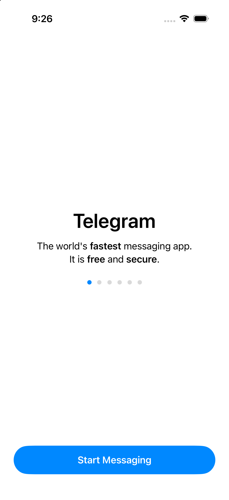

# Production readiness and integration gates

Build and live-smoke evidence: [BUILD_VALIDATION.md](BUILD_VALIDATION.md). **Final full host Debug simulator compilation/type-checking and whole-app linking passed after all source changes: 77.927 seconds, 24 actions.** On 2026-10-22, a live 8-second Saved Messages voice message was transcribed by Telegram after Premium activation and its timestamped AI Summary appeared. A user-provided simulator screenshot also showed a 1:01 message summarized through the optional chunked-speech path; one word seek was manually observed. This live evidence refers to earlier builds. Protection and cleanup evidence is limited to code tests/static checks and the full build; no signed-in runtime testing followed the final changes, and no new permission, cleanup or protection end-to-end validation is claimed. Broad interaction, accuracy, failure/scale, device/release, privacy/localization and recipient checks remain open. The installer refuses Bazel's generated lockfile change as outside its source-only audit scope; this safety check is not bypassed.

## Status

This repository is an integration candidate, not a standalone app, an App Store build, or a production certification. The official host is pinned to **`f1dd7a2dbd02cbbf513e75d5695d8d36d1cf5838`**, with the full checkout, all 13 submodules and Git LFS content present. Xcode **26.6 (17F113)**, iOS **26.5 (23F77)** and **MetalToolchain 17F109** are installed. The final full `//Telegram:Telegram` **Debug `sim_arm64` build succeeded after all source changes**, including the follow-up review fixes. Targeted Premium-simulator smoke checks in earlier builds observed a short Telegram transcript + AI Summary, a 1:01 chunked-speech summary and one word seek. Release, physical-device, broader feature UI, recipient and production verification remain open.

The [combined pinned-host patch](../Integration/telegram-ios-f1dd7a2.patch) contains the baseline integration plus direct voice-bubble access and editable quoted-body replies. It supersedes the [historical patch](../changes.patch) for this pin; do not stack them. The historical feature comparison remains against `abce7ccf9537b4074be346e852e2303c50b649fa`, not against the official host commit. Feature screenshots are historical; the new onboarding capture below is startup-only evidence. See the [host integration guide](HOST_INTEGRATION.md).

## Implemented hardening

- Follow-up review fixes (2026-10-22): temporary audio cleanup on success/error/cancellation, including pending authorization; converted files retained until the writer drains on cancellation. If the converter never terminates, cleanup cannot safely complete. Message- and peer-level protection now fails closed for acquisition/export/AI, with synchronous and asynchronous host quote rechecks. See the [dated record of both high and eight additional findings](BUILD_VALIDATION.md#follow-up-review-fixes--2026-10-22).
- Timestamped task model, parsing, separate seek target, and timestamp-preserving copy/share. Older tasks without a time decode without inventing one.
- No random/fabricated fallback in server or speech-recognition providers. Demo providers remain explicit, nondefault fixtures.
- AI invoked only on opening Summary; untrusted-transcript instructions in prompts. This is mitigation, not an injection-proof boundary.
- Lossless prompt splitting within 900 UTF-16 units: whole lines start new prompts when they fit, and oversized Unicode lines split with repeated source timestamps on continuations. Inputs needing more than 128 parts are refused.
- Sequential AI requests; generic failures retried once within each part's 30-second deadline. Any failed part invalidates the result. Large recordings can still take many minutes; cancellation and rate-limit behavior need device testing.
- Strict parsing rejects empty labeled items; timestamp validation uses each prompt's own source line starts. No invented zero-time seeks for invalid data; nearest source time accepted only within one second to accommodate display rounding. Display time floors total seconds first. This validates positioning, not semantic truth.
- All distinct merged items retained, including identical text at different source times; empty categories stay empty rather than being fabricated.
- Bounded memory-only summary/transcript caches, isolated by account and source/locale. Sensitive words and summaries are no longer newly persisted in UserDefaults or transcript cache files. Existing legacy data is not removed automatically.
- Completion state keys isolated by account/message. Completion state still stores task text in UserDefaults: replace with host-protected storage or approve this data-retention policy before release.
- Optional measured speech recognition and strict server-word matching exposed in the player menu; default remains server text with estimated timing. Measured recognition requests Speech permission on explicit selection and splits long audio into overlapping 45-second requests, restoring absolute timestamps and refusing partial results. All chunk timing is validated before filtering; overlapping contexts require lexical/timing/ownership agreement and reject disagreements. Strict speech uses a chunk-scaled 90–900-second budget, separate from the server's 90-second transcript wait; server retries wait past stale cached errors. Provenance includes `.estimated`, `.measured`, `.aligned` and `.demo`. No guarantee that recognition is local-only. Apple Speech asset loading failed on an earlier simulator attempt; a later user-provided 1:01 transcript/summary screenshot shows one successful chunked-speech run, but repeatable device/locale behavior remains unverified.
- [Strict alignment core](../VoiceTranscriptScreen/Sources/VoiceTranscriptAlignmentCore.swift), `alignVoiceTranscriptWords`, transfers recognition timestamps only after complete exact normalized positional lexical agreement. It preserves server word text, refuses insertions/deletions, unsupported tokenization, mismatches and malformed timing, and does not guess, reorder or return partial results. The [aligned provider](../VoiceTranscriptScreen/Sources/VoiceTranscriptAlignment.swift) is opt-in via **Match server words to speech timing (strict)**. Recognition times remain measured estimates; `.aligned` is not ground-truth accuracy or arbitrary-speech forced alignment.
- Share selected transcript fragments or summary key points/questions as timestamped plain text with Telegram's confirmation UI. Separately, the combined host patch makes Quote/Reply prepend an editable timestamped body blockquote and retain an ordinary native reply relationship. Existing `ChatInputContent` blocks are preserved and selection offsets adjusted rather than flattening a rich draft through attributed text. Only normal Send transmits the edited body. This is **not MTProto `quote_text`**: the server transcript is not the audio message's `message.text`. Sending, recipient rendering and draft round-trips still require validation.
- Direct voice-bubble transcription-button entry is implemented in the combined host patch, alongside the retained playback-header entry. Not device verified.
- [Integration installer](../Scripts/integrate-telegram.mjs) defaults to read-only checking, requires explicit `--apply`, checks the exact pin/version manifest and allowable changes, and never overwrites differing module content. Terminal-LF-only matches are reported separately and left unchanged.
- Portable summary/alignment Swift package, XCTest cases, standalone checks, Node installer tests, and macOS CI configuration. These do not build UIKit or Telegram.

## Required host integration

### Local verification snapshot (2026-10-22)

- Official host HEAD: pinned commit; combined host patch applied. Checkout expanded, all **13 pinned submodules initialized**, including recovered Git LFS content.
- Historical source audit: **8 module files present, 5 byte-identical, 3 terminal-LF-normalized matches, 0 missing**. The normalized count is not byte equality; existing files are left unchanged. This is not a fresh current-host audit pass.
- Xcode **26.6 (17F113)**; iOS **26.5 (23F77)** on **iPhone 17 Pro**; **MetalToolchain 17F109** available.
- Foundation package build, module syntax parsing and whitespace checks passed; separately, full host compilation/type-checking passed as described below.
- Current summary smoke: **526 assertions passed**; alignment smoke: **59 checks passed**. The core validation task passed. These test portable lexical/timing logic, not real-audio accuracy or asynchronous runtime behavior.
- Current Node suite: **18 fixture tests passed / 1 real-host audit skipped**. The strict installer correctly refuses **139 generated host lockfile additions**. Former **19 passes including real host** are historical. The obsolete host-local task file was deleted; [tasks live in the feature repository](../.vscode/tasks.json).
- Latest recorded XCTest run: **36 cases passed with zero failures under Xcode 26.6**. The [CI workflow](../.github/workflows/swift-core.yml) is configured, not claimed run. The feature validation task runs both smoke suites and Node tests, not XCTest.
- Final full-host **Debug `sim_arm64` build passed after all source changes, including the final fixes: 77.927 seconds, 24 actions**. The initial build also emitted the feature UI module and linked the whole app without feature compile fixes. Earlier incremental repeat: `Target //Telegram:Telegram up-to-date`, `bazel-bin/Telegram/Telegram.ipa`; `Build completed successfully, 1 total action`. No signed-in runtime testing followed the final changes.
- Fresh IPA unzipped into a temporary directory under the user cache, installed on that simulator, and launched as bundle `org.local.voicetranscript.CompileOnly`. The process remained alive at 20 seconds; **Telegram / Start Messaging** onboarding displayed.
- This earlier compile-only onboarding check used intentionally invalid `api_id = 0`; it was not the later signed-in live feature smoke test. The tracked [safe example](../Integration/simulator-compile-only.example.json) is a template only. Later manual smoke evidence covered one short Telegram-transcribed message with summary, one 1:01 chunked-speech message with summary, and one word seek. Release/device builds, systematic interaction coverage, send/recipient behavior and acoustic timing evaluation remain unverified.
- Host iOS 26.5 XCUITest `UITests/testLaunch`: **passed, 1 test / 0 failures** after updating the local runner to the available simulator runtime. This tests only app launch/foreground state, not transcript interactions.

### Resolved build setup issues and remaining integration steps

The [manifest](../Integration/host-manifest.json) pins Xcode **26.6**, macOS **26**, deploy Xcode **26.2**, and Bazel **9.2.0** with hash **`dd466352a3e4d3581b8898740ee1ff208866ccbe25f8d367c5dcb950219587e6`**, matching the pinned host version data. The installed Xcode is selected explicitly for the local build; relying on the system Command Line Tools fallback caused earlier SDK lookup failures. An installer source check is separate from compilation and release readiness.

Resolved local setup issues, not release certifications:

- Bazel TLS PKIX failures behind the corporate root were fixed with a **local Java truststore** under `~/Library/Caches/telegram-build-trust/bazel-cacerts`, populated from existing system public certificates. **TLS verification remains enabled.**
- Early `--action_env=DEVELOPER_DIR=…` selection fell back to Command Line Tools. Successful selection uses the chosen Xcode developer directory in **both** `--action_env` and `--host_action_env`, plus `--repo_env=DEVELOPER_DIR=…`, canonical process `DEVELOPER_DIR`, and Xcode/iOS/macOS SDK pins **26.6 / 26.5 / 26.5**.
- Absolute header inclusion failed while Xcode lived under Downloads: generated C++ builtin roots include `/Applications`, `/Library`, `~/Applications` and `~/Library/Developer`, not Downloads. Moving to user Applications fixes this path issue.
- Old disk artifacts retained stale SDK paths. The successful [feature build task](../.vscode/tasks.json) uses isolated `~/Library/Caches/telegram-bazel-xcode266`, no disk-cache option, and the pre-resolved compile-only configuration. Old caches were preserved. Canonical Xcode, both action environments and the new output base fully fixed the path failures; **TLS and header validation remain enabled**.
- The wrapper parses but does not consume `--bazelArguments` in this build path, and its build CLI does not accept `--disableProvisioningProfiles`. After initial wrapper resolution, the local raw Bazel invocation uses `--//Telegram:disableProvisioningProfiles`; do not recommend either ineffective wrapper route. See [host build details](HOST_INTEGRATION.md#build-prerequisites-and-compile-only-snapshot).

1. Preserve the successful Debug simulator setup and evidence. Configure real signing, bundle identifiers and your own valid API credentials through the **pinned upstream compilation guide** linked from [host integration](HOST_INTEGRATION.md) before live testing. The dummy fixture cannot authenticate and is not production configuration.
2. Review/preserve the generated host lockfile before expecting the strict read-only installer audit to pass. Review the combined patch, all eight module files and allowed host changes. Do not bypass rejection, stack the historical patch, reset the checkout or overwrite a differing module.
3. Complete Release and physical-device builds and review diagnostics. A basic live `composeAIMessage` summary, chunked-speech summary, one word seek and user-reported translation/search interactions have smoke-test evidence; systematic success/failure, playback, share, reply, speech-permission and device/locale coverage remains needed. Portable tests alone do not establish host compatibility.
4. Test the direct bubble transcription button and playback-header route. For Quote/Reply, start with rich drafts and nonempty selections, verify block/selection preservation, edit/remove the quoted body, then normal Send to another account. Check reply relationships, recipient rendering, cancellation and local/cross-device draft restore. Do not reinterpret this as server-verified transcript quote metadata or a guaranteed audio-time link.
5. Review Speech framework linkage, privacy purpose strings, explicit permission UX, locale support, offline behavior, conversion cleanup and data-processing disclosures. Test both optional providers, strict refusal and source switching; no permission dialog or guaranteed offline recognizer is added here.
6. Route new `NSLocalizedString` keys into the host localization pipeline, including strict-mode/provenance descriptions and task seek accessibility labels. English fallbacks are not complete localization.
7. Review legacy cached transcript/summary retention with the user before any deletion. Add logout/cache-purge hooks and protected retention as required. Account namespaces prevent cross-account cache reads, not logout erasure. Review debug AI error capture retained in the host patch separately from the module's logging hardening.

## Remaining boundaries for the original proposal

- **Broader timing accuracy still needs evaluation:** the user confirmed that tapping a transcript word landed on the spoken word for the tested sample. That is a successful manual check, not a benchmark across recordings, languages or devices. Strict lexical matching can reject text mismatches, but lexical equality alone does not validate every measured word boundary.
- **Recipient-visible body quote is implemented, not server verified:** ordinary native reply plus editable blockquoted message body replaces the historical local-only behavior. Native MTProto `quote_text` of an audio transcript and guaranteed clickable exact-time navigation are not supplied. The normal send/recipient/draft path is still unverified.
- **Direct voice-bubble entry is implemented, not device verified:** button availability, gestures, layout and permissions must be checked in the built app. It is no longer accurate to list the code entry point as missing.

## Release checklist

- [x] Final full Telegram-iOS Debug simulator build/type-check (`sim_arm64`) with pinned Xcode 26.6; final fixes compiled and whole-app linking passed after all source changes (**77.927 seconds, 24 actions**). Initial build and earlier incremental repeat also passed.
- [ ] Live permission/cleanup/protection end-to-end checks after the final changes. Current protection and cleanup evidence is code tests/static checks plus the full build only; no signed-in runtime retest was performed.
- [ ] Release and physical-device builds, signing and reproducible release toolchain/configuration.
- [x] User-confirmed transcript word tap/highlight/seek on the tested voice message; the shared screenshot showed “previously” selected at `0:04` and the player at `0:05`. The user reports this lands exactly on the spoken word for this sample. This is one-message evidence, not cross-message/language accuracy coverage.
- [ ] iPhone/iPad playback across words/long pauses, backgrounding, audio interruptions, speed changes and next/previous voice navigation.
- [ ] Verify measured word timestamps/highlighting and repeatability across devices/locales for the chunked Apple Speech path. Still test permission denial/revocation, unavailable recognizer, cancellation, download/conversion errors, strict mismatch refusal, provenance and source switching. A user-provided screenshot already documents one 1:01 message producing a summary.
- [ ] Broader real-audio timing evaluation across supported languages/tokenizations and devices. The tested sample's word-tap seek was confirmed accurate; general accuracy beyond that sample remains unevaluated.
- [x] One short live transcript and AI Summary smoke on the Premium simulator account (2026-10-22).
- [x] One >1-minute voice message completed through the chunked speech path and produced a summary in the simulator (user-provided screenshot, 2026-10-22).
- [ ] Verify the earlier 1:06 message and timing accuracy on a physical device; Telegram server transcription returned `TRANSCRIPTION_FAILED`, with no client-side one-minute cutoff. One successful long-message smoke is not broad accuracy/reliability verification.
- [ ] Summary quotas, timeout/retry, failed middle chunk, malformed output, very long recordings, Unicode, prompt injection and factual-accuracy review.
- [ ] Task timestamp taps never toggle completion; task states survive intended lifecycle and cannot leak across accounts.
- [ ] Direct bubble transcription-button and playback-header entry: eligibility, gestures, navigation and layout.
- [x] User-confirmed search highlighting and translation on the tested simulator message (manual check; not automated or broadly localized).
- [ ] Confirm clipboard contents for selected text, active search query and whole-transcript copy after the copy-scope fix; the fix is installed, but that behavior has not been manually confirmed.
- [ ] Share confirmation/recipient text; editable quoted-body reply sends correctly to another account with ordinary reply relationship, rich draft/selection preserved and draft restore tested. No `quote_text`/clickable-time claim.
- [ ] VoiceOver, Dynamic Type, RTL, localization and large timestamps on narrow displays.
- [ ] Privacy/security review, host-protected state, explicit retention, logout purging, no sensitive logs and safe temporary-file handling.
- [ ] CI green with full Xcode XCTest and summary smoke; separate alignment and installer checks recorded. No portable/syntax-only check treated as an app build or end-to-end test.

The successful full Debug simulator build and the limited live transcript, summary and one-word seek checks are explicit evidence, not production certification. Release/device, broad feature coverage, recipient and production deployment verification are not implied. All unchecked release gates remain open.